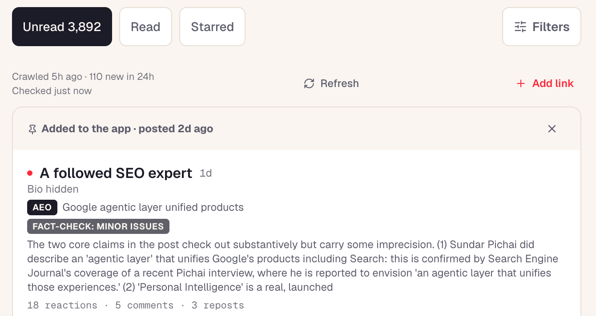

## Portfolio summary

I built a private reading app for an agency founder who kept checking LinkedIn and saving posts across task lists. The app gathered public posts into one review feed, with audio digests to listen instead of reading. Starred posts fed newsletter notes that the founder could edit before sending them to the publishing system.

## Giving a team a place to develop ideas from shared research

A useful post can give someone an idea for their own work. Following that idea takes more than saving a link. They need to read what the author actually said and think through its implications. Keeping the source available lets them return to it when they are ready to write.

I built a shared research workspace for an agency team to do that. It collects posts from selected LinkedIn and X sources, with YouTube material available alongside them. Teammates can work through the research in one place. Readers can save their own interests and discuss a source with Claude as they develop their own point of view.

### Keep the research shared and the selections personal

The feed gives the team a common collection to draw from, with unread and starred views to help each person work through it. Readers can open the material that interests them and decide what deserves a closer look.

*The feed groups unread and starred posts and shows collection status. The reader chooses when to refresh. Identifying information is anonymized.*

A star belongs to the person making the selection. It lets a reader keep something for their own work without turning every teammate’s saved post into a newsletter item. The shared collection makes material available to everyone; personal selections keep their different interests useful.

I also kept refreshing under the reader’s control. New material should not move the post someone is in the middle of reading. They can choose when to bring the feed up to date.

### Continue the thinking with the source included

The next step is often a question. A reader may understand a post’s main claim but still want to work through what it means for the subject they are writing about.

The Claude connection includes the source material when it opens the conversation. That gives the reader a starting point for discussing the argument without copying the post into another tool first. They can examine the idea and develop their own angle while referring back to what prompted it.

That was important to the product’s purpose. Collecting more posts is only useful if people can do something with the ones worth their attention. Reading and discussion belong in the same workflow because an idea often develops while someone is questioning what they have read.

### Make room for listening as well as reading

Written and narrated digests give readers another way to work through the collected research. Someone who prefers listening can hear the material without reading each post in the feed. When an idea deserves more attention, they can return to its source and continue exploring it.

I wanted audio to support that research process. Finishing a digest should leave the listener with something they can follow up on, whether that means examining the original post or discussing the idea in Claude.

The workspace also supports an owner-led newsletter workflow, with its own deliberate selections and commentary.

The product connects finding something useful with developing a response to it. The team has a shared place to discover material, and each reader keeps control of what to pursue and what they want to say.
