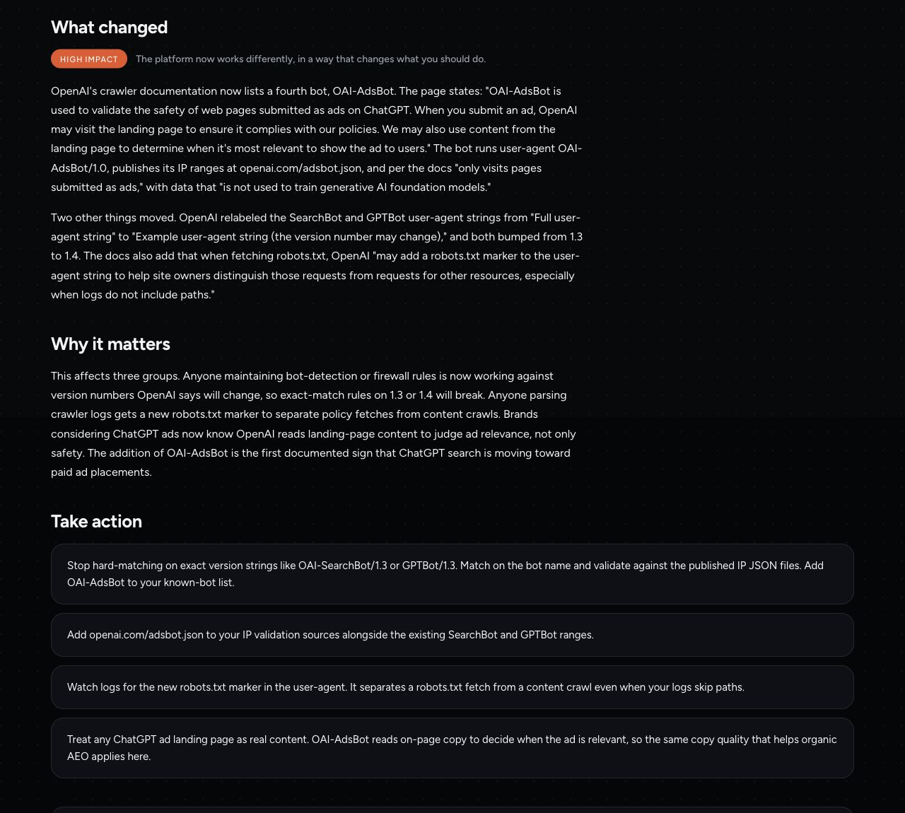
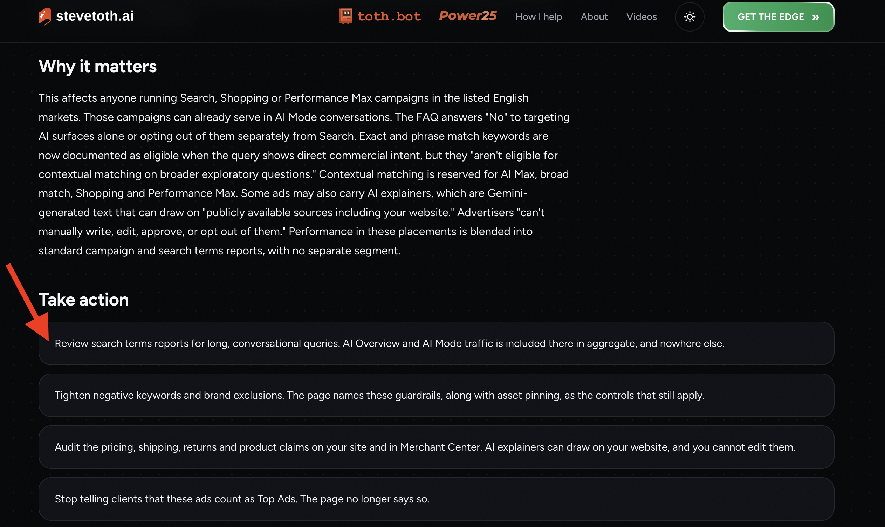
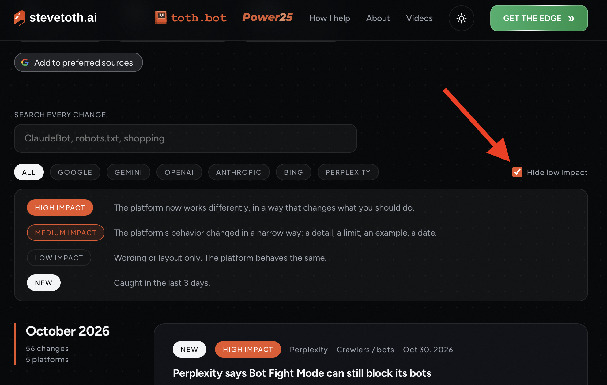
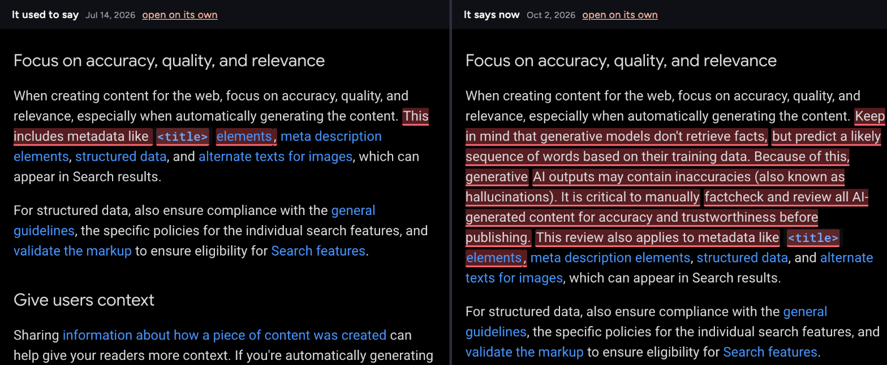

## Portfolio summary

AI Docs Watch checks the official help pages, policies, terms and API docs of Google, Gemini, OpenAI, Anthropic, Bing and Perplexity every day. When one of those pages changes, it publishes the page as it stood before and after, with the changed words marked, a plain impact rating and what the change means for an SEO or content team. I built the monitoring, the archive and the public site.

## Helping marketers understand changes in AI and what to do next

My employer told me to build AI Docs Watch to help marketers understand how AI platforms are changing how they work and what they can do about it. It monitors official pages of the likes of OpenAI, Anthropic, Google, and Perplexity AI and explains relevant updates in terms of the work marketers do.

An update can introduce a new way to reach potential customers or change how an existing capability works. However, knowing that something changed isn’t enough. You need to understand what that change makes possible and how it applies to your work. And that’s what makes AI Docs Watch a winner.

### Connect an update to a marketing decision

When OpenAI released that they read the pages submitted as ChatGPT ads, [Docs Watch recorded the addition of OAI-AdsBot](https://docswatch.stevetoth.ai/openai/crawlers-gptbot-oai-searchbot/2026-07-23/) to [OpenAI’s crawler documentation](https://developers.openai.com/api/docs/bots), and explained that landing-page content may help determine when an ad is relevant to show a user.

For a marketer preparing a campaign, that points to something specific to review: whether the destination page clearly explains the offer and who it is for. It doesn’t establish a formula for better ad performance, but it gives them a documented reason to pay attention to the page behind their ad.

That’s the connection I wanted Docs Watch to make. Readers should understand the platform change well enough to identify a useful next step, with the original documentation available if they want to investigate further.

*Docs Watch connects an addition to OpenAI’s crawler documentation with questions marketers can ask about their advertising landing pages.*

### Add more context based on the reader’s work

My employer, Steve Toth, ensured that the tool doesn’t just surfaced what changed. He ensured that every bit of new updates comes with some context about how it’ll affect what the marketer needs to do. Where the documentation supports a practical recommendation/way forward, the page also suggests what the reader can do.

For example, when Google announced that [Google Ads now show inside AI Mode automatically](https://docswatch.stevetoth.ai/google/ads-and-ai-overviews-google-ads/2026-10-29/), it presents an opportunity to paid ads teams to increase their chances of being recommended in their target audience’s AI Mode queries - or for any queries where AI Mode provides an answer.

The recommendation still needs to respect what the documentation actually says. A possible influence on ad relevance, for example, is different from a promise that changing the page will improve results. But showing what the next steps are makes it more useful for the reader.

### Help readers find the updates that apply to them

Docs Watch is designed to check documentation daily across six platforms, including Google and OpenAI. The site brings the updates together, with search and platform filters so readers can find the subjects they work on.

I also included impact labels with explanations of what each label means. Readers can hide low-impact updates when they want to focus on changes that could affect their decisions, rather than work through every changes in the AI platforms’ documentation.

*Readers can narrow the updates by platform or search for a relevant topic. The impact definitions explain how the changes are classified.*

### Make the explanation possible to check

Each update connects to the source, with saved versions that readers can compare side by side. Changed passages are highlighted, while the surrounding content remains available for context.

I included those archives so readers could check the interpretation for themselves. They can see what the publisher changed and decide whether the suggested action makes sense.

*Readers can compare the original wording behind an update, rather than relying only on the write-up.*

With AI Docs Watch, you can tell your team something has changed and show when or where. This helps you take action based on what has changed and also improves your knowledge of how AI works/changes.

Sign up to AI Docs Watch.
