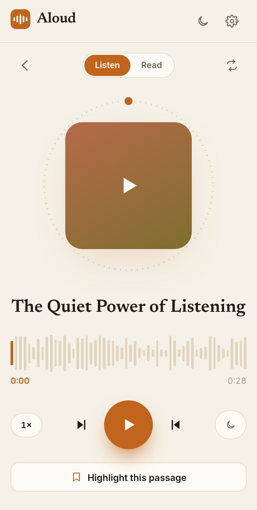

## Portfolio summary

I built Aloud with AI coding assistance because I had articles I wanted to read and kept leaving them unread. The app brought links, documents and pasted text into a personal audio library, with a reading view, saved passages and a written and spoken recap. Later, I changed narration to preserve authors' wording and prepare the whole item after I left the player.

## Case study

I had articles I wanted to read and kept leaving them unread. I also had saved documents that needed more attention than a quick scan. In June 2026, I started Aloud so I could listen to that material and return to the parts I wanted to keep.

It began as a personal app for me and my wife, with separate libraries for the people I invited. The experience followed a simple reading habit: choose something worth spending time with, then keep a way back to the passages that mattered. Audio gave me another way to spend that time without needing to read every page on a screen.

### Hearing the piece I chose

An imported article becomes a sequence of audio segments that the player joins into a listening session. Saved progress lets me continue from where I stopped. I can change the playback speed or set a sleep timer. Browsing elsewhere in the app doesn't interrupt the narration.

The first version included an AI cleanup step that could adapt imported text for speech. I later removed rewriting from the path for links and uploaded documents. When I choose an author's article, I want to hear the words they wrote. My own pasted text can still receive speech preparation, and a generated recap has a different purpose from the original work.

For public accounts, I chose to prepare audio ahead of playback instead of narrating every imported item in full. That gives the listener audio to continue with while limiting the cost of preparing sections they may never reach.

### Moving between listening and reading

I wanted to check a sentence without losing my place in the audio. Aloud has a reading view alongside the player, with a highlight showing the approximate spoken position. It helps me find my place when I switch from listening to reading.

*June 2026 build capture with the Listen and Read switch above the player and a passage-saving action below it.*

Saving a passage works from either mode. While listening, I can keep the passage being read; while reading, I can select the text I want. A saved highlight can include a note, with a route back to the source when I need more context.

This made the reading view useful beyond checking the narration. I could follow the text when a section needed closer attention and keep the exact wording I wanted to revisit.

### Returning to what I kept

“The keepers” plays audio around saved highlights. It reuses the existing narration, so returning to a passage doesn't require generating the article again. Daily Recall offers another way back by resurfacing highlights I haven't seen recently.

The weekly recap gives those saved passages a different form. Recent items are represented by their titles and authors. The recap combines that information with saved quotations; it doesn't receive every full article I've opened. I can read the recap or play its narrated version, then return to the original material when a passage deserves more attention.

Aloud began with unread articles, but finishing an item was only part of the experience I wanted. Listening gets me into the material; saving a passage gives me a reason and a way to return to it.
