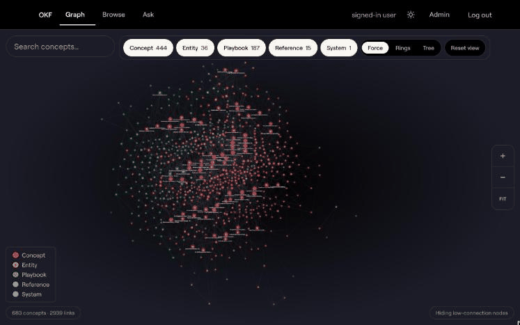
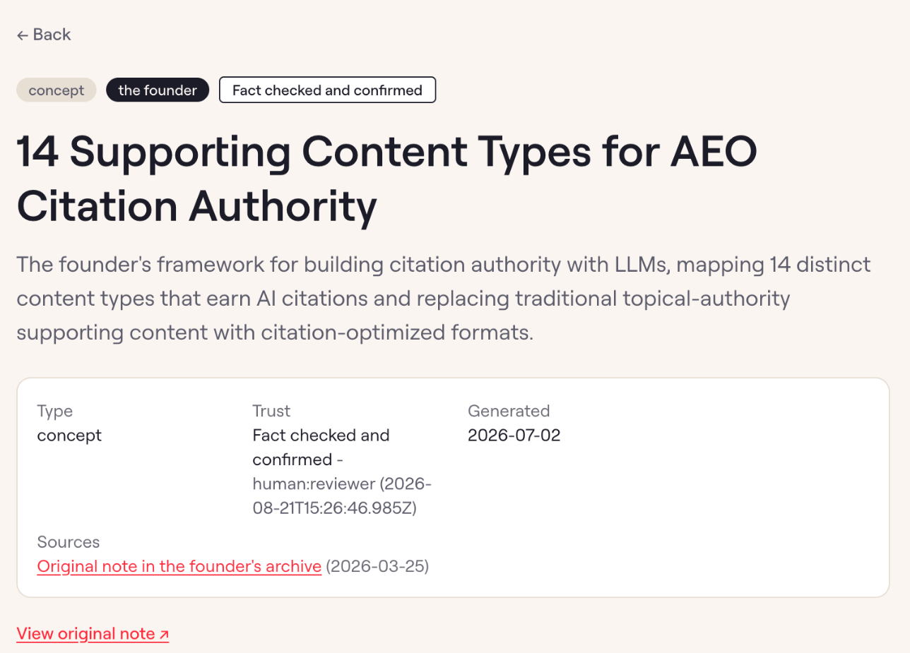
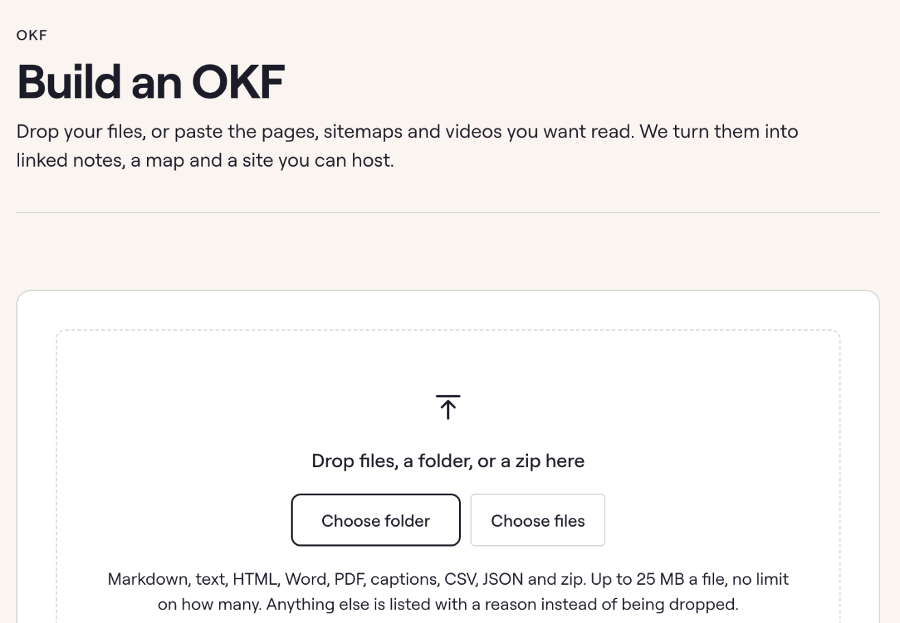

## Portfolio summary

An OKF (Open Knowledge Format) is a folder of short notes, one idea per note, each recording where it came from, whether a person checked it and when it goes stale. I turned an SEO agency founder's 1.23 million words of notes into an OKF of 683 linked notes. The team can ask it questions and get answers that cite the exact notes they came from. I then built a kit that does the same for a client's own documents, which the client hosts themselves.

## Case study

The agency founder had years of thinking spread across Notion archives and an AI project. When the team needed guidance, they could ask the founder or search that material themselves. Finding a relevant page still left them to work out which part answered their question.

I organised the archive into linked notes and built a way for teammates to ask questions against them. The aim was to make the founder's recorded thinking useful without requiring the founder to explain it again each time.

### Turn the archive into notes people can follow

An OKF, or Open Knowledge Format, is a folder of short text notes, with one idea per note. Related notes link to each other, so a teammate reading a concept can continue into the procedure that uses it.

Each note keeps its source reference and review status. A freshness date indicates when the material should be checked again. This context travels with the note, allowing someone who did not write it to see where it came from before applying it.

*The knowledge map shows connections between notes in different layouts. This is a historical screen; the on-screen totals belong to that capture.*

### Answer the question, then show the notes

A teammate asks a question in the app. The answering workflow finds relevant notes through an index, then reads the selected notes in full. It uses that material to produce an answer with citations to the notes behind it.

The teammate can open a citation and read the complete note, rather than accepting a summary without its context. When the collection does not cover a question, the answer should acknowledge that gap. Outside material must remain distinguishable from the founder's own thinking.

A note's review information matters alongside its citation. An automated source check can help catch an inaccurate extraction, but it does not replace a person's review of the guidance. The stored review details identify who checked the note.

*Source and human-review information on an individual note.*

### Review additions before they become guidance

The agency's knowledge will keep changing. New material can be added through links or pasted text, with a choice that identifies whether it comes from the founder or an external source.

The ingestion workflow prepares proposed notes and changes to existing ones. It pauses for an admin to review the plan before publishing. This gives a person a chance to correct the interpretation or reject an addition before teammates use it as guidance.

### Give clients their own knowledge collection

I later adapted the approach into a kit for a client's own documents, separate from the agency's internal knowledge collection.

A strategist or client supplies the source files. The kit produces linked text notes and a static website for browsing them, including a map of their connections. The client can host that website without depending on the agency's infrastructure.

*The client-kit input screen, where a build starts with the client’s own source files.*

The client keeps the notes as readable files, so the collection can remain useful after the original project is over. They can consult the material independently and maintain it as their own work changes.
