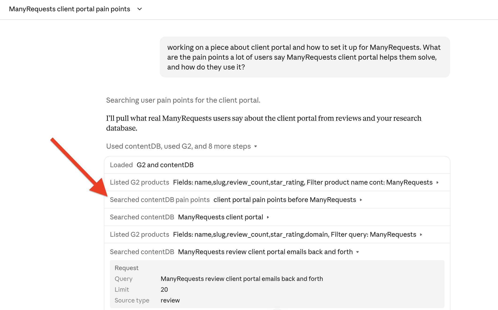
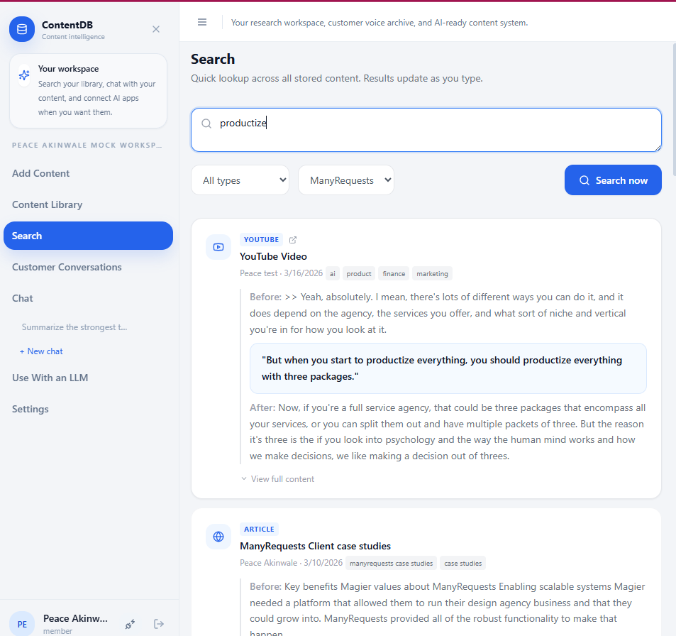

## Portfolio summary

I built ContentDB with AI coding assistance to collect articles, video transcripts, documents and pasted text in one library. The build connected importing, client-based organization and search with a chat where you could bring a particular source into a question. It also gave a connected AI assistant tools to search the library and open a complete source.

## Case study

A useful detail from a customer interview can be hard to find when you're finally ready to write about it. You may remember the point without remembering which of your transcript contains it. And finding a sentence that sounds relevant still leaves a question: does the source actually support what you want to say?

I built ContentDB around that part of my writing process. It stores existing research material and every context about my client so I can retrieve relevant passages and examine their context while I write.

This way, when I’m trying to know more about a topic and what my client’s team (thought leaders, product team) have said about a product or a topic, I simply ask it questions, and the AI’s responses is grounded in the material I have added. This means I didn’t have to copy and paste context manually; the AI assistant I’m using can use the context from their material to know more about what I wanna write about.

### Keep the source available after saving it

You can add articles or video transcripts to the library. You can also upload documents of paste texts.

These become searchable sources with their original text attached. A writer can return to the material behind a result instead of relying on a saved link or a summary.

The import method matters because it affects what the writer can trust. PDF and Word extraction preserves the source's words rather than rewriting them. Where a model transcribes material, or an import is incomplete, ContentDB warns the reader. Those warnings matter when a passage might become a quotation in someone else's work. A transcript also needs an actual source for a speaker's name; a plausible label is not enough for attribution.

The library also keeps a source's title and URL where available. A useful passage retains a route back to where it came from, including when an assistant retrieves it later.

### Read around the match before using it

Search retrieves passages by meaning, so the writer doesn't have to remember the exact wording. It also brings back neighboring text. That gives a short quotation enough context to show whether the speaker qualified the point or was answering a narrower question.

*Historical demonstration of quotation context in an earlier ContentDB interface. The matching passage appears between the text before and after it; this is not a capture of the current UI.*

Search results and chat citations open the source at the relevant passage. The writer can move from an answer to the material behind it without beginning the search again. That connection is particularly useful when an answer seems reasonable but the wording in the source is more limited.

For example, a passage about one customer's experience may support a specific example in a draft. It cannot, on its own, establish that every customer has the same experience. ContentDB exposes the material needed to make that judgment; it doesn't automatically decide that a claim is true.

### Use the same research from an assistant

I added an MCP connection so a compatible AI assistant can search the stored sources and open an item. A writer can ask the assistant to find material relevant to a draft, then inspect the passages it returns. They don't need to locate the documents manually and paste them into the conversation first.

That is the workflow I wanted ContentDB to support: start with expertise already recorded, then recover enough context to use it responsibly. The writing decision stays with the person who will put their name on the draft.
