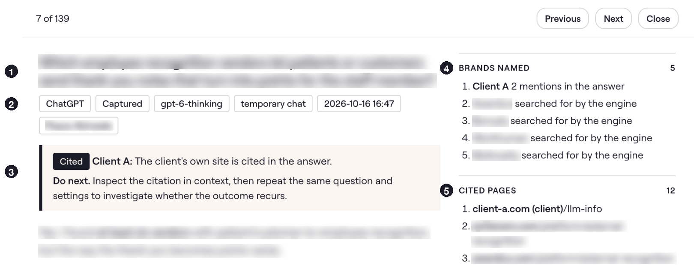
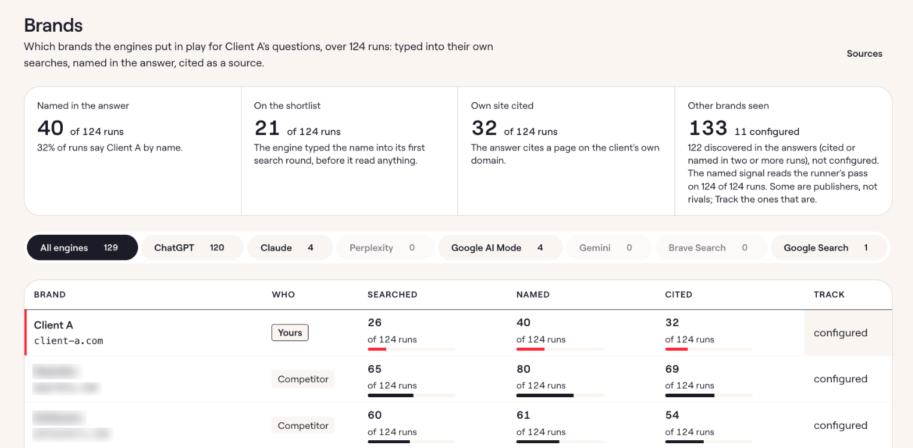
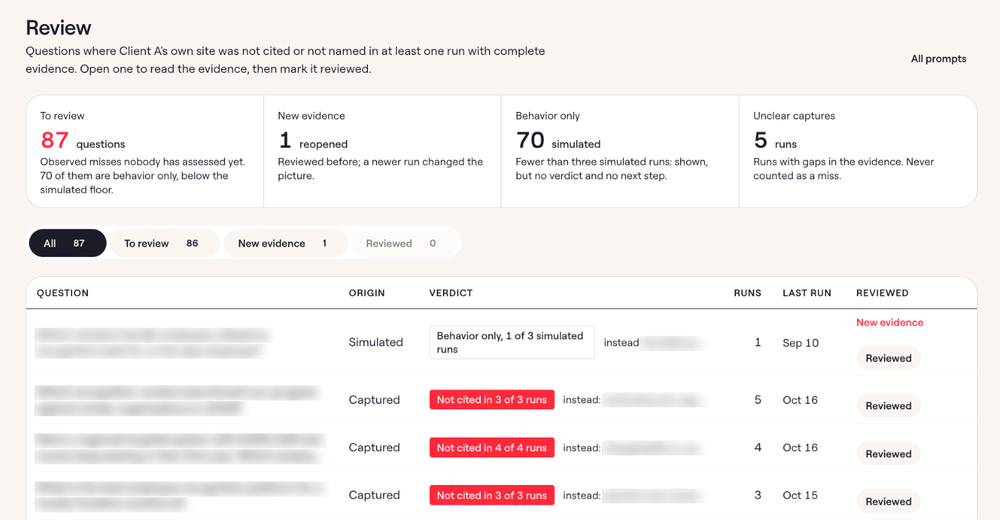

## Portfolio summary

I built a fanout query analysis tool for an agency’s content strategists, extending a teammate’s bookmarklet into a Chrome extension and shared dashboard. It records the searches behind AI answers and distinguishes returned pages from citations. Strategists can review client visibility and send the recorded material to Claude for analysis.

## Case study

A client can be named in an AI answer without receiving a link. Its website can also appear in search results without being cited. For a content strategist, these are different outcomes, and the final answer alone does not show enough to investigate them.

I built Fanout to keep the available search evidence alongside each answer, organised by client. A strategist can see where the client appeared and inspect the sources cited in the answer.

### From a bookmarklet to a shared investigation

A teammate had already built a bookmarklet and parser that captured ChatGPT's searches and associated pages. Using it meant activating the bookmarklet for each prompt, then downloading files to upload to Claude. I extended that starting point into a Chrome extension and shared dashboard.

The strategist selects a client in the extension, then asks questions in a supported AI app. The extension records the available search activity and response. Each saved answer becomes a run, so the team can return to that client's research without reconstructing it from downloaded files.

*A captured answer, with its recorded citations and brand mentions. Client details are masked.*

### See how the client appeared

The dashboard distinguishes a page returned during search from a page cited in the answer. If a client's page was returned but not cited, the strategist can inspect it alongside the sources that did receive citations. That gives them a specific comparison to make when deciding what to investigate further.

Brand mentions are recorded separately. An answer might recommend the company without linking to its website, or cite its website without naming the company. Keeping these separate helps the strategist describe what happened without treating every appearance as the same result.

*The Brands view keeps brand mentions separate from website citations. Client and competitor identities are masked.*

### Review a larger set of answers

For larger question sets, I added a service that submits prompts through OpenAI's API with web search enabled. The strategist can collect answers without entering every prompt manually. These runs are labelled “Simulated” to distinguish them from recordings made in the consumer apps.

The Review page flags questions where a complete run did not name the client or did not cite its website. Incomplete captures get a separate count. A strategist can open the underlying runs and mark questions reviewed, so the team can see which gaps someone has examined.

*The review queue identifies captured and simulated runs. Incomplete captures have a separate count; research questions are masked.*

The capture only shows activity the app made available. Some recordings include returned pages without the wording of the searches that produced them. Missing search wording remains unknown; it is not evidence that no search occurred. A run also cannot establish why a platform chose one source over another.

### Take the evidence into analysis

The strategist can choose a client and date range before exporting the recorded material. Send to Claude opens a run, or a filtered set of runs, with the team's analysis instructions included. This removes the file-transfer steps from the original bookmarklet workflow while keeping the analysis tied to a chosen set of answers.

The goal is for the strategist to analyse each response they get and, if useful, create a dashboard for the client. Each run records one answer at one moment, so future answers may differ. The shared record gives the team something concrete to compare as they continue that investigation.
