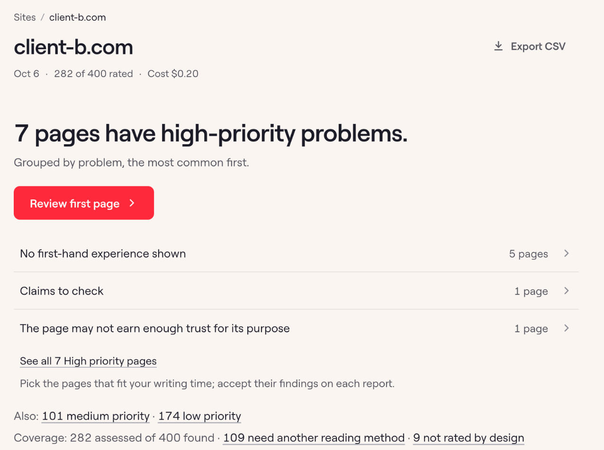
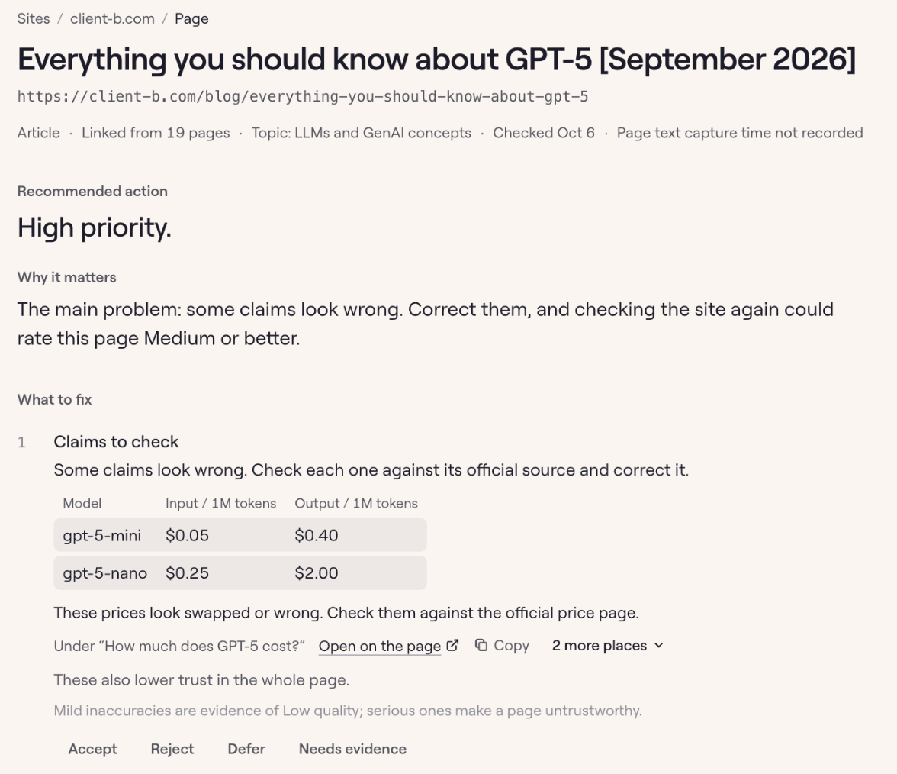

## Portfolio summary

Google employs human quality raters who judge pages against its quality guidelines. Quality Rater uses those guidelines to flag pages for human review. It assigns provisional ratings and links findings to passages, helping a writer decide what needs attention. It's a work in progress: live for the agency's team, with accuracy measurement as the next stage.

## A prototype for finding pages worth a closer review

A content audit becomes difficult to manage when every page produces a long list of possible improvements. The reviewer needs a sensible place to begin and enough context to decide whether a flagged issue is real.

I built Quality Rater as a prototype for that work, using the Search Quality Rater Guidelines as a starting point. It proposes page ratings and review priorities, then connects individual concerns to passages a strategist can inspect. It is an independent project, not a Google product, and its judgments still need evaluation against human reviewers.

### Give the reviewer a manageable starting point

The run screen groups suggested priorities and recurring findings. A strategist can look into a concern that appears across several pages before deciding how much attention it deserves.

*The run screen groups suggested review priorities and shows how much of the site was assessed. Identifying information is anonymized.*

I wanted each finding to give the reviewer something specific to examine. Pages are divided into numbered sentences so the model can point to a passage, and a second pass checks those selections. That makes a concern easier to investigate; it does not establish that the concern is correct.

### Leave the judgment with the person checking the page

The report shows the passage behind a proposed fix. The reviewer can accept or reject the suggestion and record their reasoning. They can also leave it for further investigation.

*A report points to the passage behind a concern so the reviewer can accept or reject it. They can defer it when more investigation is needed.*

A reviewer can also request a rewrite through the draft checker. That request follows a human decision rather than automatically treating every flagged passage as something to change.

### The quality of the suggestions still needs work

The useful test is whether this helps a person find issues worth addressing without filling their audit with false alarms. Agreement with human reviewers has not yet been measured, so I am not treating the prototype’s ratings as validated judgments or predictions about search performance.

This is still a work in progress, and I’ll update this page when the feed isn’t as noisy as it is right now.
