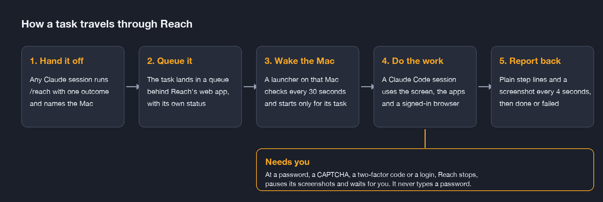
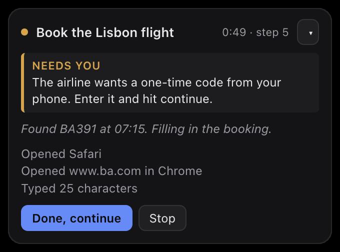

## Portfolio summary

Reach is a personal tool I built so my AI coding sessions stop waiting on me. When a session hits a step that only works on my Mac's screen, like an app setting, a signed-in browser, an extension's own page or a device sign-in code, it hands the task to Reach. Reach starts a Claude Code session on the selected Mac. Its dedicated browser handles the tested workflows; broader desktop-app control remains the next step.

## Handing an AI coding task to the Mac that can finish it

An AI coding session can write an extension and still need help loading it into a browser for testing. The work has reached my computer, but the conversation handling the build may not have access to the right browser there. I built Reach to make that handoff possible without asking me to carry each instruction and result between sessions.

Reach receives a task and routes it to the selected Mac. It starts a local Claude Code session, which uses tools on that machine to complete the task. Reach coordinates the handoff and makes its progress visible.

### Pass on the task and bring back the result

The requesting session describes the outcome it needs and names the Mac. Reach queues the task and starts a local session when there is work to do. The result returns to the session that asked for it, so the original build can continue with the answer.

*The diagram shows the task handoff and the point where the owner is asked to take over.*

For browser work, the local session uses a dedicated Chrome profile. That gives extension testing a browser of its own, rather than trying to automate my everyday profile. For example, I used it to load the Fanout extension into that dedicated browser for testing.

### Keep the handoff visible when I need to intervene

A status view and small overlay show the task’s progress. I can stop it, and the session can ask me to take over when it reaches a sign-in or another step that needs my involvement.

The handoff rules tell the session to leave passwords and verification codes to me. Screenshot capture pauses while it waits for that input. These decisions matter because a useful local assistant still needs a clear boundary around access to my accounts.

*Scripted demonstration of the sign-in handoff. The flight task illustrates the interface; it is not evidence of a booking.*

I also made sessions start for queued work and close when idle. Leaving a local agent running between tasks had created another thing to watch. Starting it when needed made the coordination easier to manage.

### What the handoff can do so far

The demonstrated work is narrower than general control of desktop apps. Browser testing already provides a useful reason for the handoff, while broader native-app workflows still need end-to-end verification.

That is the part I wanted Reach to solve first: when a build needs something done on my Mac, the request can reach the right local session and return with a result. I can see when it needs me without having to relay the whole task myself.
