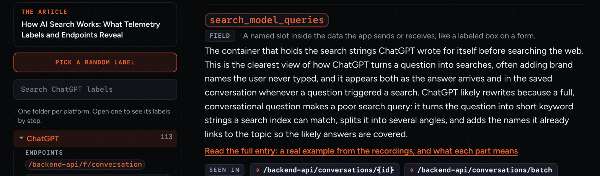
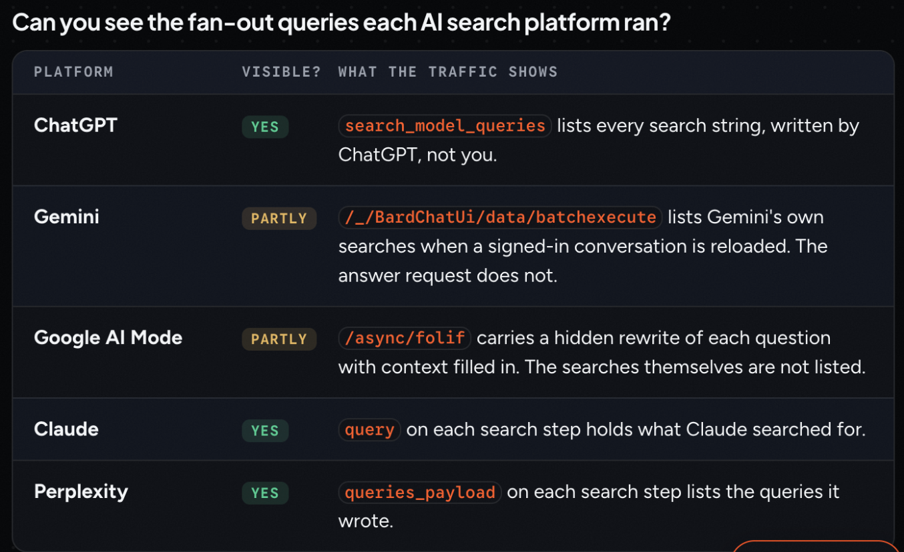

## Portfolio summary

When you ask ChatGPT, Claude, Perplexity, Gemini or Google's AI Mode a question, the app sends and receives data in the background: the searches it writes, the pages it pulls in, the sources it attaches to each sentence. I recorded hundreds of real AI search conversations, built the pipeline that turned that traffic into a labeled reference, and published it as a public article with eight platform pages and narrated audio. A reader can look up the field names catalogued from the recorded sessions and see what it holds, where it appears and whether that meaning was observed or inferred.

## Turning recorded AI search traffic into a reference researchers can use

An AI search answer does not show everything a researcher may want to inspect. The browser also exchanges data containing search records and references to source pages. Those records use field names that can be hard to understand without an example.

I turned recorded traffic into a public reference so researchers could look up those fields and examine the data behind an explanation. The reference gives them a starting point for interpreting their own recordings, with a distinction between what we observed and what we inferred.

### Start with real recorded conversations

The source material included 284 conversations I recorded and cleaned in September 2026 across several AI search products. A teammate chose the sessions to record. I captured them and removed personal and account data. I also built the parsers needed to read the different formats.

I then built the pipeline that organized the apps’ own requests and response fields into reference entries. Filtering out unrelated website tracking kept the reference focused on the AI search exchange rather than everything the browser happened to load.

### Let a reader follow the explanation back to an example

An entry explains what a field appears to contain and links to a recording example. Someone looking at the same field in their own capture can compare the values and decide whether the explanation fits.

*A reference entry explains a recorded field and links to an example, while marking interpretation as uncertain.*

The cross-platform comparison helps readers see which kinds of evidence were visible in the recorded traffic. Search queries, for example, were not equally exposed across the platforms. That matters when planning an investigation: a missing record limits what someone can conclude from the capture.

*The comparison summarizes what the recorded traffic exposed on each platform. It describes the recordings behind the reference, not a guarantee of current behavior.*

### Keep interpretation separate from observation

Seeing a field’s values does not automatically establish its purpose. The entries mark uncertain explanations with language such as “likely” so readers can distinguish an interpretation from something directly visible in a recording.

The reference is therefore a guide to observed traffic, rather than official platform documentation or access to a model’s internal reasoning. A reader can use the examples to test an explanation against their own evidence.

The founder later edited and extended the pages. I preserved that editorial version for subsequent updates rather than allowing my earlier generator to overwrite it. Narrated versions also followed the edited page text, keeping the listening version aligned with the reading version.

### Use the reference with the date in mind

AI products change, and a field that appeared in one set of recordings may change or disappear in another. The reference is grounded in the sessions we collected, including the September 2026 material, rather than a promise that every future response will follow the same format.

A researcher can start with an explanation and an example instead of deciphering every field from scratch. They still need to compare it with the traffic in front of them. Making that check possible is what gives the reference its value.
